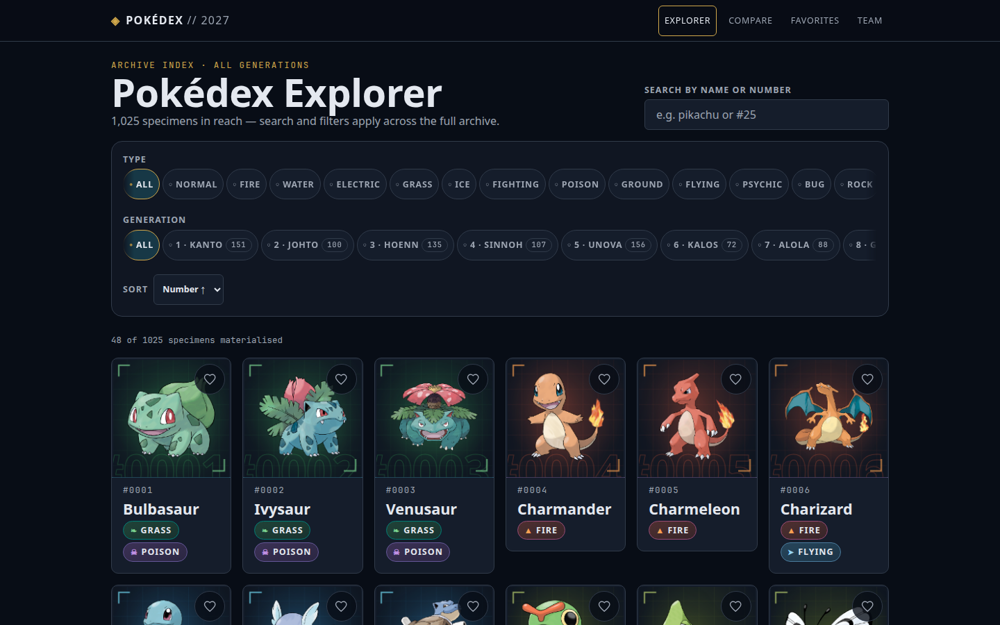
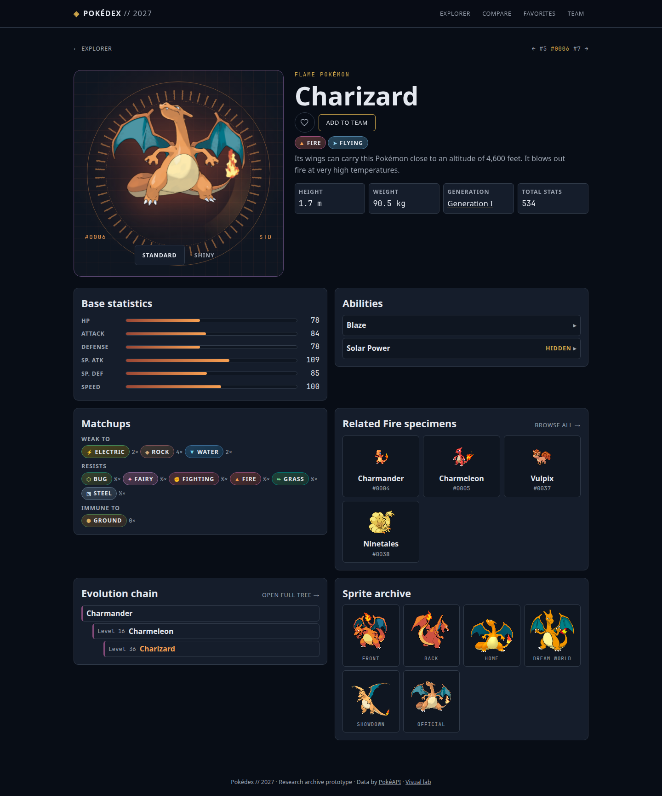
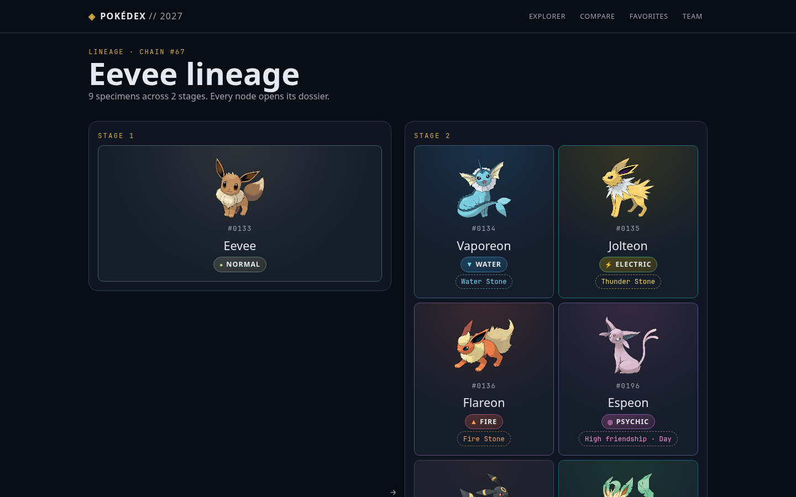

# Pokédex // 2027

An advanced Pokémon research interface: browse 1025 species, inspect scanner
dossiers, trace evolution lineages, compare stats side by side, and assemble
a local team — powered by [PokéAPI](https://pokeapi.co).



## What is this project

It is the classic frontend learning project (the PokéAPI Pokédex every
developer builds at some point), taken seriously and **AI-boosted**: the
human leads, agents execute. The whole process is documented and auditable —
`docs/DECISIONS.md` records every decision (D-001…D-019), `docs/PROGRESS.md`
narrates every iteration, and there is a real-browser audit in
`docs/AUDIT_2026-10-09_BROWSER.md`.

If you come to learn, this repo teaches: React 19 + TypeScript with layered
architecture, genuinely modern CSS (`oklch`, `color-mix`, container queries,
view transitions on the backlog), cached API consumption, three-level
testing, AA accessibility, and performance budgets. Follow the suggested
order in [How to study it](#how-to-study-it).

## Features

- **Explorer** — global search (name/number), 18 type filters,
  9 generation filters with counts, 4 sort orders, infinite scroll; everything
  mirrored in shareable URLs.
- **Dossier** — scanner hero (reticle + holographic artwork), shiny toggle
  (`?shiny=1`), biometrics, stats, on-demand abilities, sprite archive,
  defensive matchups, related specimens, evolution preview, prev/next stepper
  with prefetch.
- **Evolution explorer** — branching trees as tiered stages with trigger
  conditions; every node opens its dossier.



- **Compare** — accessible pickers, semantic delta table with text verdict,
  swap, random pair; shareable `?left=&right=` URLs.
- **Favorites & Team** — local-only, versioned persistence with migration
  and malformed-data safety, cross-tab sync; six-member team with reorder and
  type composition.
- **Visual lab** (`/lab`) — type matrix, specimen studies, primitive playground.



## Commands

Requires Node ≥ 20.19.

```bash
npm install
npm run dev        # http://127.0.0.1:5173
npm run build      # production artifact in dist/
npm run preview    # serve the production build
npx vitest run     # unit + component (79 tests, no network)
npx playwright test # E2E against live PokéAPI (60 flows)
npx tsc -b         # typecheck
npx eslint src --max-warnings 0
npx prettier --check .
```

Unit tests use stable fixtures and never touch the network. E2E runs against
live PokéAPI with one retry for transient throttling.

## Project composition

The golden rule: **the UI consumes domain models only** — raw API shapes never
leak into components.

```
src/
  api/pokeapi/   client (error taxonomy), DTOs, endpoints, mappers,
                 query keys + TanStack Query options
  domain/        pure logic with tests: pokemon, evolution, explorer, type
  features/      screens: pokedex, pokemon-details, evolution, compare,
                 favorites, team-builder
  components/    ui primitives (Button, TypeBadge, StatBar…), motion, ErrorBoundary
  app/           router (per-route lazy), layout, providers, pages, styles/tokens
  lib/           versioned storage, helpers (titles, formatting)
e2e/             smoke, explorer, detail, evolution, compare, collections,
                 responsive, keyboard, contrast, reduced-motion, runtime,
                 accessibility (axe), web-vitals
docs/            product, architecture, design system, roadmap, decisions,
                 progress, browser audit…
```

State lives where it belongs: URL for browsable state (filters, compare,
shiny), Query for server state (24h stale / 7d GC cache, no retry on 404),
Context + versioned localStorage for collections. Per-route code splitting
and CSS-first effects (no WebGL in V1 — see D-019 in `docs/DECISIONS.md`).

## Key technical decisions

- **Respectful PokéAPI usage**: one canonical index
  (`GET /pokemon?limit=2000` → species ≤ 1025), bounded detail batches, type
  documents shared between roster/relations/matchups. Verified at volume:
  480 cards → 1 index + 480 unique detail requests, zero duplicates, no
  waterfalls.
- **Native modern CSS**: `oklch` tokens, `color-mix`, 18 type identities via
  `data-type` (never color-only), tilt/foil via CSS vars written in rAF
  (zero re-renders per `pointermove`).
- **Measured performance, not promised**: LCP ~0.5s, CLS < 0.06 on the
  production build; lazy images with reserved aspect ratios; in-grid skeletons.
- **Accessibility as a feature**: landmarks, skip link, keyboard flows with
  visible focus, `aria-pressed` states, text before color,
  `prefers-reduced-motion` everywhere, 44px targets, axe WCAG 2A+2AA clean on
  every route.

## Deployment

Live at **https://pokemon.marcovillanueva.com** (Cloudflare Pages,
git-connected: every push to `main` auto-deploys with `npm run build` → `dist/`).

`dist/` is a static site; client routes need an SPA fallback:

- Netlify: `public/_redirects` (`/* /index.html 200`) included.
- Vercel: `vercel.json` rewrites included.
- Cloudflare Pages: `public/_redirects` is honored as-is (verified live:
  `/pokemon/charizard` serves the SPA shell with HTTP 200).
- Any static host: serve `index.html` for unknown paths.

## How to study it

1. Read `docs/PRODUCT.md` → `docs/DESIGN_VISION.md` → `docs/ROADMAP.md` →
   `docs/PROGRESS.md` (order matters: the what before the how).
2. Walk the app with DevTools: Network (watch the index + batches),
   Performance (LCP/CLS), and the accessibility tree.
3. Study one full vertical slice: `api/pokeapi` → `domain` →
   `features/pokedex` (the path a datum travels to the pixel).
4. Read `docs/DECISIONS.md` looking for what was **rejected** (three.js,
   animation libraries, Zustand for server state): it teaches more than what
   was accepted.
5. Break something on purpose and let `tsc` + `eslint` + the tests explain
   it; then check `e2e/` to see how a real flow gets pinned down.

## Visual design

Scientific archive × premium device × holographic collectible. See
`docs/DESIGN_VISION.md`, `docs/DESIGN_SYSTEM.md`, and the decision log
`docs/DECISIONS.md`.

## Author

Built by **Marco Villanueva** — human-led, AI-boosted.

## License

MIT — see [LICENSE](LICENSE).
